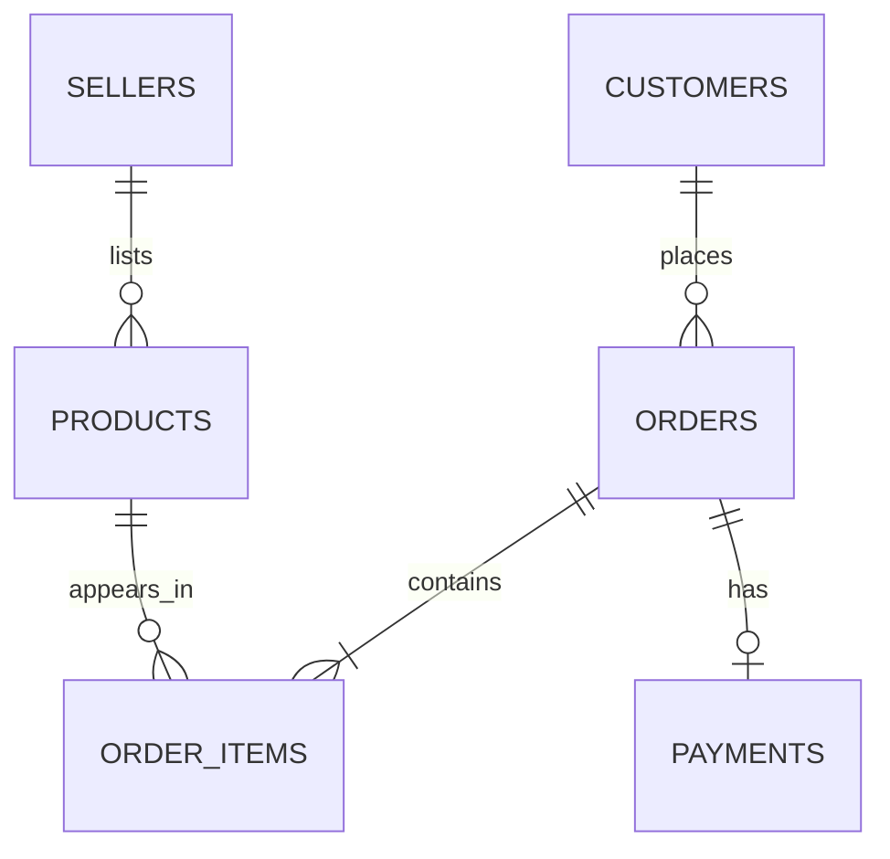

# E-Commerce Sales & Customer Analytics (MySQL)

An end-to-end SQL portfolio project that models a small online marketplace and analyzes sales, customers, products, sellers, orders, and payments using MySQL 8.0+.

## Business problem

An e-commerce team needs reliable answers about product and category performance, customer repeat behavior, seller contribution, geography, order value, payment outcomes, and sales over time. The analysis must preserve purchase-time prices and avoid inflating totals when one order has multiple item rows.

## Objectives

- Build a relational six-table MySQL database with integrity constraints.
- Generate repeatable sample data for realistic e-commerce scenarios.
- Answer at least 25 business questions using beginner through advanced SQL.
- Keep order item sales, order value, and successful payment value clearly distinguished.
- Document query results and findings from actual database execution.

## Technologies

- MySQL Community Server 8.0+
- SQL (including MySQL stored procedures and views)
- Visual Studio Code
- Git and GitHub

## Repository structure

```text
.gitignore
README.md
sql/
  01_schema.sql
  02_seed_data.sql
  03_verify_data.sql
  04_beginner_analysis.sql
  05_intermediate_analysis.sql
  06_advanced_analysis.sql
docs/
  business_questions.md
  business_insights.md
  database_schema.md
  phase_2_plan.md
  github_publish_checklist.md
results/
  README.md
  04_beginner_analysis.tsv
  05_intermediate_analysis.tsv
  06_advanced_analysis.tsv
  result_index.md
scripts/
  run_analysis.ps1
```

## Database structure

The database is named `ecommerce` and contains `customers`, `orders`, `products`, `sellers`, `order_items`, and `payments`.



See [database_schema.md](docs/database_schema.md) for the table grain, keys, constraints, and relationship details.

## Dataset

The deterministic SQL seed uses seed `20261117` and generates 500 customers, 35 sellers, 120 products, 1,500 orders, 4,500 order item rows, and one payment row per order. It includes eight product categories, multiple Indian customer and seller locations, six payment methods, and all requested order/payment states. The project owner has confirmed Phase 2 table counts and integrity checks against the local MySQL database.

The generator uses fixed deterministic calculations rather than unseeded randomness. Running `02_seed_data.sql` again clears and replaces sample rows in all six tables. Run it only in the project database.

`order_items.unit_price` stores the price at purchase time. Use `quantity * unit_price` for historical item sales; `products.list_price` represents the current catalog price.

## Revenue definitions

- **Delivered item sales:** sum of `order_items.quantity * order_items.unit_price` for orders with status `Delivered`. This is the project's primary merchandise sales measure.
- **Order value:** sum of item line values within a single order. Aggregate item rows to one row per order before joining one-to-one payment data.
- **Successful payment value:** sum of `payments.payment_amount` for successful payment rows. Returned orders retain their original successful payment; refunds are not modeled, so this amount is before refunds and is not net revenue.
- **Attempted/expected payment amount:** stored in `payments.payment_amount` even for pending or failed attempts; filter by `payment_status` before treating it as settled.

The analysis SQL avoids joining raw payments to multiple item lines when summing payment amounts. This prevents payment totals from being multiplied by the number of order items.

## Business questions and SQL techniques

There are 29 questions across [beginner](sql/04_beginner_analysis.sql), [intermediate](sql/05_intermediate_analysis.sql), and [advanced](sql/06_advanced_analysis.sql) scripts. They cover catalog and order inspection, customer and seller performance, category/city/monthly trends, payment outcomes, subqueries, CTEs, `CASE`, date functions, `RANK`, `DENSE_RANK`, `ROW_NUMBER`, running totals, a view, and a stored procedure. Each SQL question has a comment explaining its business problem, SQL technique, logic, and use. The full index is in [business_questions.md](docs/business_questions.md).

### Beginner (Q01–Q09)

1. Which pending orders have the oldest order dates?
2. Which product categories are in the catalog?
3. Which ten catalog products have the highest current list prices?
4. Which products are running low on stock?
5. Which Mumbai customers signed up most recently?
6. Which orders were placed in January 2026?
7. What payment methods appear in payment records?
8. Which orders have failed payment attempts?
9. Which products were added to the catalog most recently?

### Intermediate (Q10–Q19)

10. How many units and how much delivered item sales did each category generate?
11. How did delivered item sales change by calendar month?
12. Which categories generated at least 100 delivered units?
13. Which five customers generated the most delivered item sales?
14. Which customers placed at least two delivered orders?
15. How do sellers compare on delivered sales and order reach?
16. Which customer cities contribute the most delivered item sales?
17. What is the average successful payment amount by method?
18. How many payment attempts occurred for each method and outcome?
19. What are average, minimum, and maximum item totals by order status?

### Advanced (Q20–Q29)

20. What is delivered item sales by month with a cumulative running total?
21. Which products rank highest by delivered sales within each category?
22. Which sellers lead by delivered item sales, and how do ties rank?
23. What is each customer's most recent order?
24. Which customers' delivered item sales exceed the customer average?
25. How did monthly delivered sales change versus the prior month?
26. What is the monthly delivered sales summary available to dashboards?
27. What are the top products in a chosen category?
28. Do payment attempts equal their corresponding order item totals?
29. How do customer cities rank by delivered item sales?

## Run the project

1. Install and start MySQL Server 8.0+.
2. Open PowerShell at the repository root. Replace `YOUR_MYSQL_USER` with your local account. `--password` prompts locally; do not put a password into a command or commit it.
3. Run the schema, seed, and verification scripts in order:

```powershell
$mysql = 'C:\Program Files\MySQL\MySQL Server 8.0\bin\mysql.exe'
& $mysql --user=YOUR_MYSQL_USER --password --batch --execute="source sql/01_schema.sql"
& $mysql --user=YOUR_MYSQL_USER --password --batch --execute="source sql/02_seed_data.sql"
& $mysql --user=YOUR_MYSQL_USER --password --batch --execute="source sql/03_verify_data.sql"
```

4. Run the analysis scripts and save their result sets under `results/`:

```powershell
& .\scripts\run_analysis.ps1 -User 'YOUR_MYSQL_USER'
```

The runner prompts for the local MySQL password for each analysis file and saves tab-separated outputs as `results/04_beginner_analysis.tsv`, `results/05_intermediate_analysis.tsv`, and `results/06_advanced_analysis.tsv`. Running it again overwrites those snapshots with the latest results. The advanced script creates/replaces one view and one stored procedure and calls the procedure. Update [business_insights.md](docs/business_insights.md) only from these actual outputs.

The local `mysql.exe` may need its full path if it is not on PATH. If your database already contains project tables, inspect it before running the seed because the seed replaces their rows.

`01_schema.sql` is a one-time bootstrap for an empty `ecommerce` schema. It uses plain `CREATE TABLE` statements and will report an error if those tables already exist; do not rerun it over an existing project database.

## Results and key findings

The three analysis scripts were executed against the actual MySQL database. Their tab-separated results are saved under [`results/`](results/), with a query-to-output index in [`results/result_index.md`](results/result_index.md). Key findings and recommendations tied to query IDs are in [`docs/business_insights.md`](docs/business_insights.md). Amounts are in dataset currency units; the database does not store a currency code.

- Delivered item sales total **24,873,109.44** across **1,125 delivered orders**; delivered-order AOV is **22,109.43**.
- Electronics contributes **13,430,272.02** (about **54.0%**) of delivered item sales. Its leading product, Wireless Headphones Model 049, generated **1,885,231.26** from 117 units.
- The highest-sales customer city is Kochi (**2,771,152.60**); the top seller is seller ID 31 (**2,097,378.70**).
- The strongest complete month is March 2025 (**1,470,824.34**). July 2026 is partial and excluded from complete-month comparisons.
- Debit Card has the highest average successful payment amount (**25,970.79**), while payment-method attempt counts/outcomes are perfectly balanced by the synthetic seed.
- Customer repeat activity is intentionally patterned by the generator and is not a representative retention benchmark.

## Limitations

- This is deterministic synthetic data, not real customer or transaction data.
- One payment row per order models a simplified payment lifecycle.
- Returned orders retain their original successful payment; refund or reversal transactions are not modeled.
- The dataset has no shipping, discount, tax, inventory history, or product price history beyond purchase-time item price.
- Delivered item sales are a merchandise measure, not accounting-recognized net revenue.

## Project status

Phases 1–5 are complete. The analysis outputs and business findings are documented. Phase 6 is prepared locally: the Git repository is initialized, a `.gitignore` and [publishing checklist](docs/github_publish_checklist.md) are in place, and the project has not been committed or published to GitHub.
