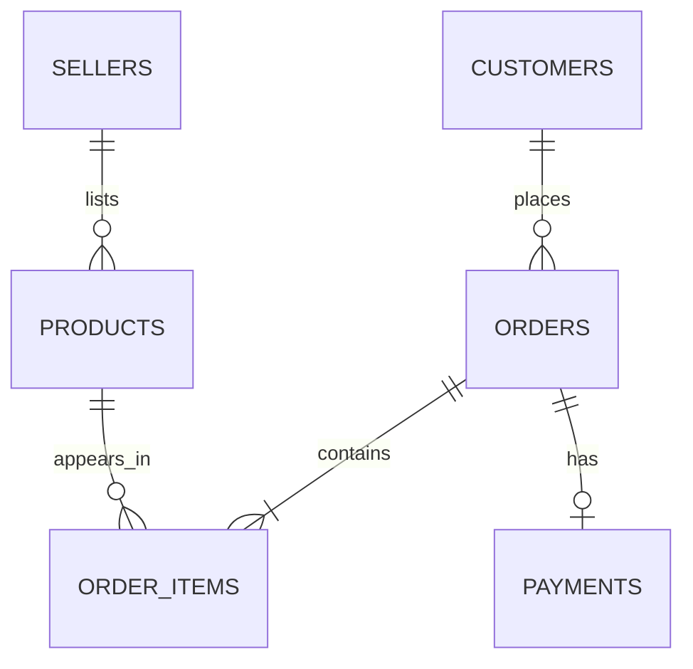

# Database Schema

The project uses a normalized six-table MySQL schema with InnoDB foreign keys. Primary keys identify rows; foreign keys ensure related rows exist. `DECIMAL` stores money exactly to two decimal places.

## Relationships

| Table | Grain (one row means...) | Important columns |
|---|---|---|
| `customers` | One customer | unique email and phone; location and signup date |
| `sellers` | One seller | unique email; business location |
| `products` | One product currently listed by one seller | category, current `list_price`, stock |
| `orders` | One order from one customer | timestamp and constrained lifecycle status |
| `order_items` | One distinct product within an order | quantity and purchase-time `unit_price` |
| `payments` | One payment attempt/record per order in this sample | method, attempted/expected amount, timestamp, constrained status |

`order_items.unit_price` is a snapshot captured when a sale occurs. Historical sales calculations must use `quantity * unit_price`, not the product's current `list_price`. Product plus order is unique within order items to avoid duplicate product lines in an order. An order can contain many item rows; each order has one sample payment row. `payments.payment_amount` is the attempted or expected order amount; `payment_status` says whether it settled. Cancelled orders have failed attempts, avoiding an unrepresented successful charge. Returned orders retain their original successful charge; refunds are not modeled in this sample and should be treated as a limitation.

CHECK constraints reject invalid statuses, categories, methods, non-positive product prices/quantities, and negative payment amounts. Indexes support the planned joins and common filters/groupings by dates, status, customer, seller, category, city, and payment method. MySQL 8.0.16+ enforces CHECK constraints.

## Column reference

| Table | Column | Type | Meaning / rule |
|---|---|---|---|
| customers | `customer_id` | `INT UNSIGNED` | Primary key |
| customers | `first_name`, `last_name` | `VARCHAR(60)` | Customer name fields |
| customers | `email` | `VARCHAR(254)` | Required, unique; basic email-shape CHECK |
| customers | `phone` | `VARCHAR(25)` | Required, unique |
| customers | `city`, `state` | `VARCHAR(80)` | Customer's recorded location |
| customers | `signup_date` | `DATE` | Registration date |
| sellers | `seller_id` | `INT UNSIGNED` | Primary key |
| sellers | `seller_name` | `VARCHAR(120)` | Display name; not unique in the generated sample |
| sellers | `email` | `VARCHAR(254)` | Required, unique; basic email-shape CHECK |
| sellers | `city`, `state` | `VARCHAR(80)` | Seller's recorded location |
| sellers | `signup_date` | `DATE` | Seller registration date |
| products | `product_id` | `INT UNSIGNED` | Primary key |
| products | `seller_id` | `INT UNSIGNED` | Required FK to `sellers` |
| products | `product_name` | `VARCHAR(160)` | Product display name |
| products | `category` | `VARCHAR(60)` | Required; restricted to the eight project categories |
| products | `list_price` | `DECIMAL(10,2)` | Current catalog price; positive CHECK |
| products | `stock_quantity` | `INT UNSIGNED` | Current sample stock count |
| products | `created_at` | `DATE` | Catalog creation date |
| orders | `order_id` | `INT UNSIGNED` | Primary key |
| orders | `customer_id` | `INT UNSIGNED` | Required FK to `customers` |
| orders | `order_date` | `DATETIME` | Order timestamp |
| orders | `order_status` | `VARCHAR(20)` | `Delivered`, `Pending`, `Cancelled`, or `Returned` |
| order_items | `order_item_id` | `BIGINT UNSIGNED` | Primary key |
| order_items | `order_id` | `INT UNSIGNED` | Required FK to `orders` |
| order_items | `product_id` | `INT UNSIGNED` | Required FK to `products` |
| order_items | `quantity` | `SMALLINT UNSIGNED` | Positive CHECK |
| order_items | `unit_price` | `DECIMAL(10,2)` | Purchase-time unit-price snapshot; positive CHECK |
| payments | `payment_id` | `INT UNSIGNED` | Primary key |
| payments | `order_id` | `INT UNSIGNED` | Required, unique FK to `orders`; one sample payment row per order |
| payments | `payment_method` | `VARCHAR(30)` | One of six constrained payment methods |
| payments | `payment_amount` | `DECIMAL(12,2)` | Attempted/expected order amount; non-negative CHECK |
| payments | `payment_date` | `DATETIME` | Nullable for pending attempts |
| payments | `payment_status` | `VARCHAR(20)` | `Successful`, `Pending`, or `Failed` |

The schema does not include a currency code, refund record, status-history timestamp, or inventory transaction table. Amounts therefore have no explicit currency, returned-order payments remain gross before refund, elapsed time in status is unavailable, and stock cannot be reconstructed historically.
